# PatentSecure

### The AI patent agent that reads the register for you — with tamper-evident on-chain verification on Solana

[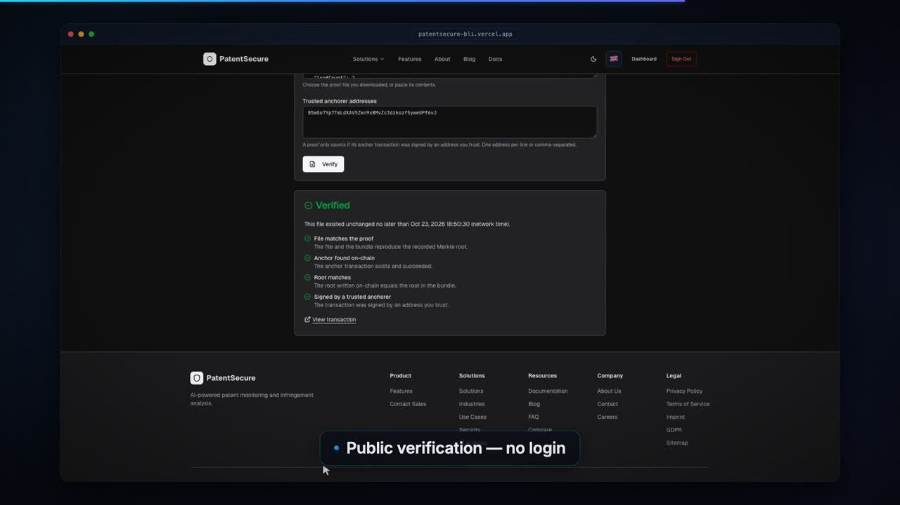](https://youtu.be/IMHwuXq-s6s)

> **BLI Legal Tech Hackathon 2 submission** · Tracks: **LegalTech & RegTech** · **AI × Blockchain**
> Demo: https://patentsecure-bli.vercel.app

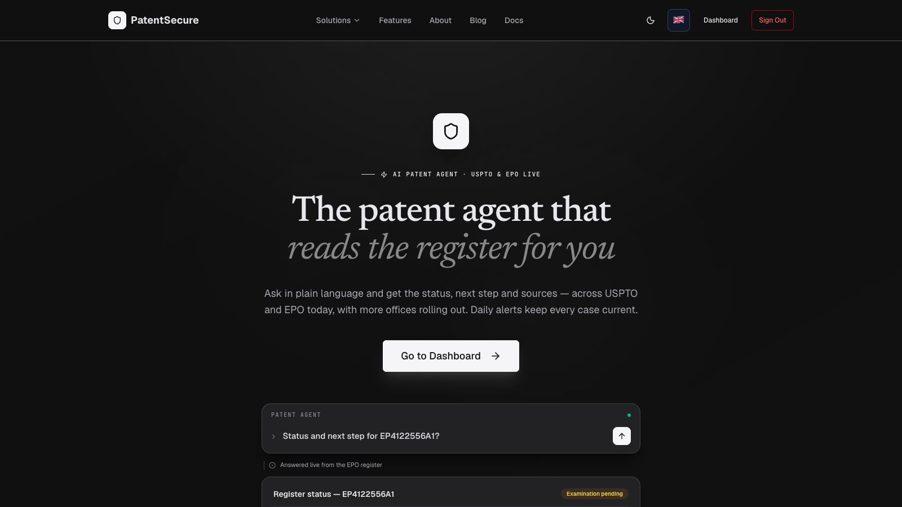

We enter the hackathon with **PatentSecure**, an agent-first patent-intelligence platform: an AI agent with 30+ specialised tools, daily monitoring and alerts, freedom-to-operate, invalidity, file and office-action analysis, live register lookups (USPTO and EPO today), a team workspace and **on-chain verification**: every invention disclosure and every AI analysis can be fingerprinted in the browser, batched into a Merkle tree, **anchored daily on Solana in one signed Memo transaction**, and verified later by anyone, **without revealing the content**.

| | |
|---|---|
| **What it is** | PatentSecure — an agent-first patent-intelligence platform with on-chain verification (the Proof Layer) |
| **Demo video** | [YouTube](https://youtu.be/IMHwuXq-s6s) |
| **Live demo** | https://patentsecure-bli.vercel.app (password-gated test instance; access details are in the submission form) |
| **Public verification page** | `/en/verify` on the demo instance, or build the backend-free page from this repository |
| **Chain** | Solana (devnet for this submission; the adapter is cluster-agnostic) — Memo program + Solana Attestation Service |
| **This repository** | Source code of one PatentSecure component — the on-chain verification (Proof Layer) — plus the full description of what we submit |
| **On-chain verification** | One of PatentSecure's features: tamper-evident timestamps and an AI audit trail on Solana (the Proof Layer) |

---

## Contents

1. [See it](#1-see-it)
2. [The problem](#2-the-problem)
3. [PatentSecure — the whole product](#3-patentsecure--the-whole-product)
4. [**On-chain verification: the Proof Layer**](#4-on-chain-verification-the-proof-layer)
5. [How the pieces fit — architecture](#5-how-the-pieces-fit--architecture)
6. [Try it: judge quick-start](#6-try-it-judge-quick-start)
7. [What is in this repository](#7-what-is-in-this-repository)
8. [Quality, security and honesty](#8-quality-security-and-honesty)
9. [Why it fits the tracks](#9-why-it-fits-the-tracks)
10. [Roadmap](#10-roadmap)
11. [Links and license](#11-links-and-license)

---

## 1. See it

**Video:** [YouTube](https://youtu.be/IMHwuXq-s6s) — the product (live agent answer from the EPO register, monitoring cockpit, AI-scored alerts, competitors, freedom-to-operate), then the Proof Layer end to end on Solana devnet: add a disclosure and an AI audit trail, anchor, download the bundle, verify publicly, change one character and watch verification fail, issue a passport, link a wallet.

| Ask the agent — live register, sources cited | Monitoring cockpit |
|---|---|
| 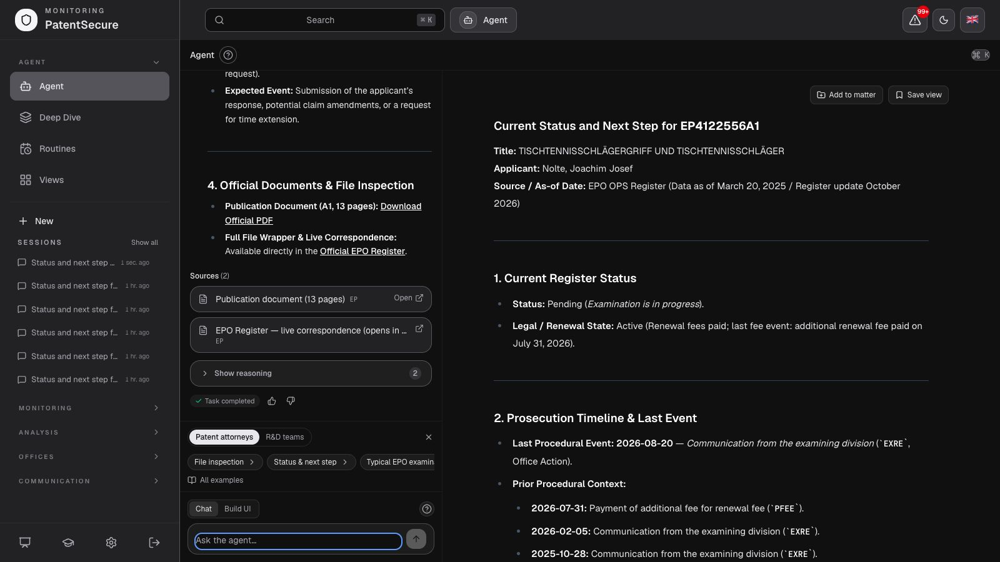 | 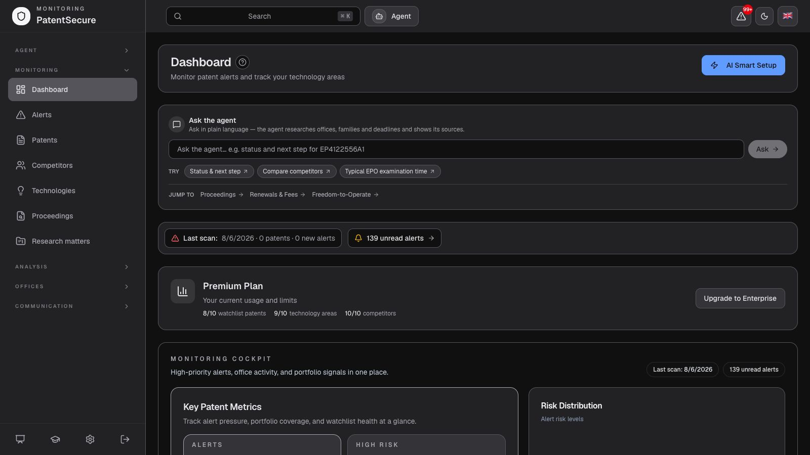 |

| Proof Layer in the dashboard | Public verification: **Verified** |
|---|---|
| 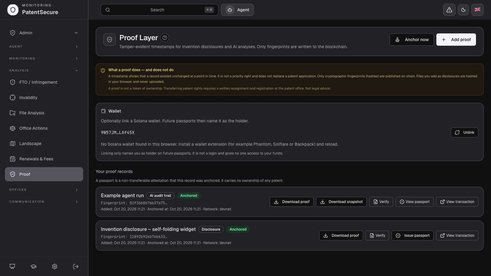 | 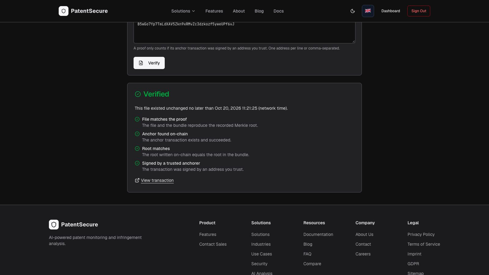 |

---

## 2. The problem

**Patent work is fragmented and slow.** Every office has its own portal, login and export. A simple "what is the status and what do I have to do next?" turns into an afternoon of tab-juggling. Monitoring the filings of competitors, checking freedom to operate and answering office actions are manual, expensive and easy to get wrong.

**And there is no good evidence for *when* and *how*.** Inventors and IP teams must be able to show *when* a disclosure existed and *how* an AI-assisted analysis (freedom-to-operate, invalidity, an office-action draft) came about — without publishing the content, which is confidential and often novelty-critical. Today that rests on internal logs and trust. AI makes it more pressing: an analysis that cannot be shown to be unchanged is hard to rely on, hand to a client or defend later.

**PatentSecure's answer:** one agent for the whole patent workflow, and a proof layer so that what the agent and your team produce can be **timestamped and audited without disclosure**.

---

## 3. PatentSecure — the whole product

PatentSecure is the submission. This section describes the platform; section 4 describes its on-chain verification, the Proof Layer.

### 3.1 The agent — one conversation for the whole workflow

Ask in plain language. The agent plans the work, calls the right tools across offices and your own data, and answers with **sources you can open** and an auditable reasoning trace. Results appear as interactive artefacts in a canvas: timelines, claim charts, tables and custom widgets.


**30+ specialised tools**, chained by the agent as needed:

| Group | What it covers |
|---|---|
| **Patents & offices** | Search, patent details, family, register status, procedural timeline, legal status, file inspection, office statistics |
| **Deep analysis** | Freedom-to-operate, invalidity charts, file-wrapper analysis, office-action response drafting, side-by-side comparison |
| **Deep dive & landscape** | Chained deep dives that carry findings from stage to stage; landscape and whitespace reports |
| **Your workspace** | Dashboard queries, watchlist, competitors, technology areas, alerts, monitoring, routines, saved views, memory |
| **Client outbox** | Draft client emails from a case — nothing leaves the outbox until an attorney approves and releases it |
| **Web & widgets** | Live web search and fetch with cited sources; build and refine bespoke interactive widgets |

Agent runtime: planning loop with a self-registering tool registry, per-day token and monthly cost budgets enforced before every run, persistent memory, compaction of tool results, prompt caching, and a multi-provider AI fallback chain across major AI providers. An SSRF guard protects web fetches.

### 3.2 Monitoring and daily alerts

Add technologies, competitors, patents or just describe your business: **AI Smart Setup** turns a plain-language description into a complete monitoring configuration. A **daily scan** fetches new filings, matches them against your technology areas, competitors and watchlist, runs AI triage and a claim-by-claim analysis, and creates alerts. **Daily** email alerts and a daily digest bring the high-risk matches to your inbox. (Daily, deliberately — not a promise of instant delivery.)

| Monitoring cockpit | AI-scored alerts |
|---|---|
|  | 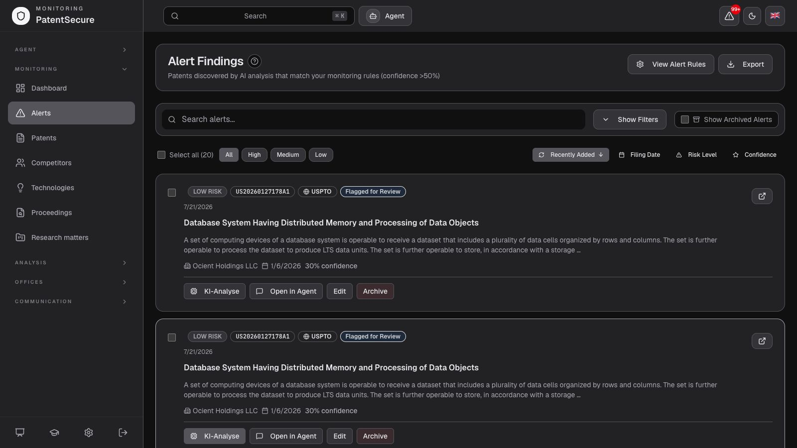 |

- **Confidence-scored infringement analysis** per match — claim by claim, High / Medium / Low, with recommendations. AI noise reduction keeps irrelevant filings out of the inbox.
- **Competitor Radar** — every new filing from companies you track, grouped by competitor and technology area, separate from infringement risk; email digests in several languages, deep-linked into the dashboard.
- **Patent watchlist, technology-area keyword monitoring, rights monitoring by applicant, inventor or class (IPC/CPC), custom combinations.**
- **Expiry calendar and renewals** — a calendar view of every USPTO and EPO patent's freedom-to-operate date, urgency colours, day-level drill-down, matched against your watchlist, competitors and technology areas.
- **Chat with any patent** — ask questions about claims, description and risk in natural language.

| Competitor watchlist | Renewals, fees & expiry |
|---|---|
| 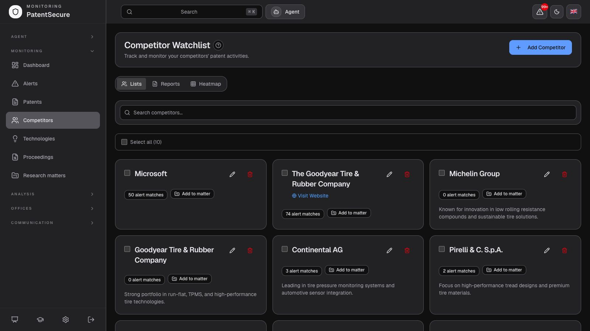 | 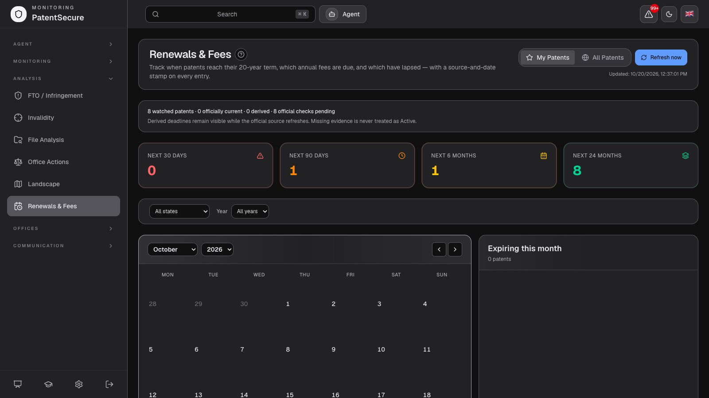 |

### 3.3 Analysis modules

All results are stored, reviewable, overridable (with a mandatory reason and an append-only audit trail) and clearly marked as **AI drafts for professional review — not legal advice**.

- **Freedom-to-Operate** — charts your product against patent claims limitation by limitation, with a traffic-light read (disclosed / suggested / not found) on every element. Every finding rests on a **search scope you can audit**: databases, jurisdictions and queries, screened vs. analysed — not a black box.
- **Invalidity** — assemble prior art and map it against the claims you want to challenge.
- **File analysis / dossier** — read claims, history and family without leaving the workspace.
- **Office actions** — turn an examination report into a structured response plan: every objection mapped to the claim and statutory basis it raises, cited prior art from USPTO and EPO at hand, a first-draft response you refine. Nothing is filed without your sign-off.
- **Deep Dive** — multi-stage analysis chains that share one reasoning record, so each step builds on the last.
- **Landscape** — technology landscape and whitespace views.

| Freedom-to-operate | Deep Dive |
|---|---|
| 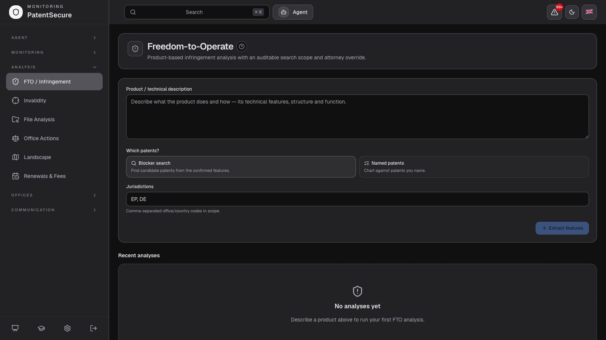 | 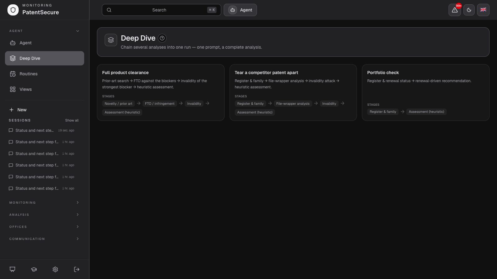 |

### 3.4 Offices, proceedings and the live register

PatentSecure queries the offices **live — not a stale copy**: every answer is read from the official register at the moment you ask. A **capability-tiered office registry** resolves every lookup to the best available source and always reports which tier answered, so coverage stays honest:

1. **Native adapters** (full coverage) — EPO OPS and Register, USPTO Open Data Portal, DPMA connect, Global Dossier.
2. **EPO DOCDB backbone** (partial, marked degraded) for offices without a native adapter.
3. **Deep links** into the official registers (always resolves).

**USPTO and EPO are live today; more offices are rolling out** (ten offices appear on the coverage map). The **proceedings monitor** tracks register events across your cases and delivers them as a daily alert; **inbound office mail** is parsed into office events; **renewal watch** creates renewal notifications; a worldwide file lookup resolves one case number across every connected office.

### 3.5 Automation: routines, views, outbox

- **Routines** — scheduled agent jobs (daily or weekly) that check your patents and offices and email you the results.
- **Saved views** — turn any question into a saved, shareable view your team returns to; views are built from agent recipes and diffs.
- **Client outbox** — agent-drafted client updates wait for attorney approval before anything is sent, with saved senders.

### 3.6 Teams, onboarding, platform

- **Team workspace** — several users on one shared company dataset, with every action scoped to the organisation and optimistic-lock guards on shared data.
- **Interactive tour and showcase** — a guided walkthrough with demo fixtures; **AI Smart Setup**; a browsable library of ready-to-run prompts.
- **8 languages** (en, de, fr, es, pl, pt, it, nl), global search (⌘K), analytics with risk distribution and trends, CSV/PDF export, admin tooling with an audit log.
- **Security:** hashed credentials, JWT sessions, Google OAuth with PKCE, CSRF protection on all state changes, per-endpoint rate limits, Zod validation, strict CSP and security headers, company-scoped queries everywhere, fail-closed cron and inbound endpoints, GDPR export and deletion.
- **Business model:** B2B subscription; packages via sales today, transparent self-serve pricing is being introduced.

### 3.7 PatentSecure vs. doing it by hand

| The task | By hand, office by office | With PatentSecure |
|---|---|---|
| Check one case across offices | Log into each register, search the number again | One case number resolves across every connected office at once |
| Follow a multi-country proceeding | Track each national file in its own portal and language | Family members are linked and their register events tracked together |
| Stay on top of new events | Re-check portals by hand and risk overlooking a change | A daily alert email with the changes |
| Answer a status question | Rebuild the timeline from exported PDFs | Ask in plain language, get status, next step and sources in seconds |
| Run a freedom-to-operate check | Assemble prior art and map claims in a spreadsheet | Claim charts with an auditable search scope for the attorney |
| Track expiries and deadlines | Keep your own calendar | Expiries and response deadlines surfaced and filtered |
| **Prove when and how it was done** | Internal logs, email trails, trust | **Hash-only proofs anchored on Solana, verifiable by anyone** |

---

## 4. On-chain verification: the Proof Layer

> **A timestamp is not a priority right.** A proof shows that a record with exactly these bytes existed, and was committed by the operator's anchor key, no later than the on-chain time of the anchor transaction. It does not replace a patent application, is not an assignment of rights, does not prove an AI analysis is *correct*, and is not legal advice. Details in [4.6](#46-what-it-deliberately-does-not-claim).

### 4.1 What you get

| Capability | What it does |
|---|---|
| **Disclosure timestamps** | A file or text is fingerprinted (SHA-256) **in your browser**; only the fingerprint is sent. A random 32-byte salt keeps guessable documents unprovable by third parties |
| **AI audit trail** | An agent run (steps, sources, result) or a stored FTO / invalidity / file analysis is frozen into a canonical JSON snapshot (RFC 8785) and fingerprinted. Provider-internal model identifiers are stripped from the snapshot |
| **Daily Merkle anchoring** | Pending records are batched into an RFC 6962 Merkle tree; the root is written to Solana in **one signed Memo transaction per day** (or on demand). Idempotent, resumable, per-run capped |
| **Public verification** | A backend-free page and a CLI recompute the hash locally, check the Merkle path, read the anchor transaction from a public RPC and verify root, leaf count and **signer**. A tampered file fails; an unreachable network is reported as `unreachable`, never as a verdict |
| **Proof bundle + exact snapshot** | Download both: the bundle proves inclusion, the snapshot is exactly what was committed |
| **Passport** | For an anchored record, the issuer can create a **Solana Attestation Service** attestation (kind, batch root, anchor time, holder). Issuer-controlled, non-transferable record — **not** a token, not ownership. Per-tenant cap and atomic reservation protect against cost drain |
| **Wallet link (Sign-In-with-Solana)** | Link a wallet by signing a single-use server challenge (Wallet Standard: Phantom, Solflare, Backpack, …). The server verifies the Ed25519 signature and re-checks domain, nonce and time. It only names the holder on future passports — it is not a login and touches no funds |
| **Agent tools** | `list_proofs`, `verify_proof`, `anchor_analysis_proof` (only after the user explicitly confirms) — the agent can anchor its own analysis |
| **"Anchor as proof"** | A button in the FTO, invalidity and file-analysis views |
| **8 languages** | The Proof page and the public verify page are fully translated |


### 4.2 How it works

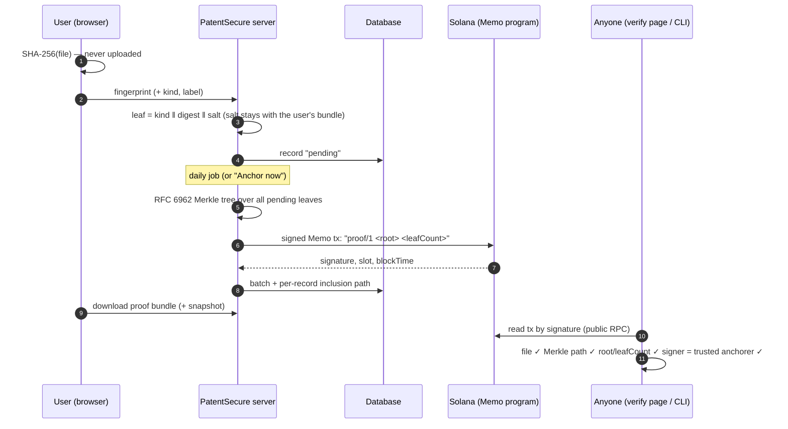

### 4.3 Construction

```
contentDigest = SHA-256(file bytes)           (or SHA-256(JCS(json)) for structured records)
leaf data     = kindTag(1) ‖ contentDigest(32) ‖ salt(32)        kind: 1 disclosure · 2 ai_trace · 3 analysis
leaf hash     = SHA-256(0x00 ‖ leaf data)     node hash = SHA-256(0x01 ‖ left ‖ right)     (RFC 6962 / 9162)
anchor memo   = "proof/1 <root hex> <leafCount>"   — a *signed* Solana Memo instruction
```

- **No smart contract to trust.** Verification pins the transaction's **signer** to a published anchorer address, because the Memo program lets anyone write any text. Without that check, a stranger could "anchor" a fake root.
- **Salted leaves** make a guessable document unprovable by anyone who does not hold the bundle; deleting salt and record makes the on-chain entry permanently unlinkable ("crypto-shredding" — a design property, not a legal guarantee under GDPR).
- **Domain separation by kind tag** prevents replaying a disclosure leaf as an AI-trace leaf.
- **Tree size is authenticated by the memo** (`root` + `leafCount`), which the verifier compares — an inclusion path alone binds leaf, root and index, not the size.
- **Only hashes leave the machine**; contents are never uploaded or written on-chain.

### 4.4 Verification requires all four

| Check | Meaning |
|---|---|
| `merkle` | file digest + bundle salt + path reproduce the bundle root (offline) |
| `chain` | the anchor transaction exists, succeeded, and contains exactly one well-formed proof memo |
| `root` | on-chain root and leaf count equal the bundle's |
| `anchorer` | the transaction's fee payer **signed** it and is in the verifier's published trusted set |

| Verified | Tampered — one character changed |
|---|---|
|  | 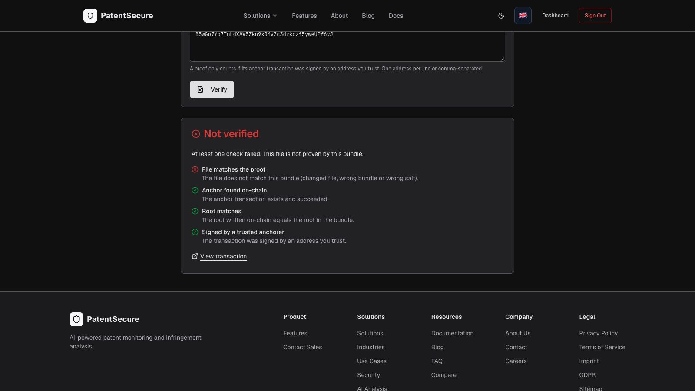 |

### 4.5 On-chain evidence (Solana devnet)

| What | Where |
|---|---|
| Anchorer wallet (signs every batch) | [`B5wGo7Yp7TmLdXAV5Zkn9xRMvZc3dzkozf5yweUPf6vJ`](https://explorer.solana.com/address/B5wGo7Yp7TmLdXAV5Zkn9xRMvZc3dzkozf5yweUPf6vJ?cluster=devnet) |
| Passport issuer wallet | [`CqeUXaJBZrt7Zcjn3NVnGTWn8UkoziktCCszpVrVNetz`](https://explorer.solana.com/address/CqeUXaJBZrt7Zcjn3NVnGTWn8UkoziktCCszpVrVNetz?cluster=devnet) |
| Example batch (three documents, shipped in `examples/devnet`) | [`iMiFpvUi…HE52FG`](https://explorer.solana.com/tx/iMiFpvUihH8odt6WtQsVgXdXEokp26nUrF46zD4c52n7GohYrt737sHzjJaBg1DdVhViQd32f85uycYL8HE52FG?cluster=devnet) |
| Anchor from the live instance (smoke test) | [`21hYNsR7…K7q7`](https://explorer.solana.com/tx/21hYNsR7NjdsQAjVjGCQQsdTWc4QaPVYTw9ra3jAN8M1aSKSZPQE3v42THECvNUAnyjMJ4ftkh3nBVW4pb7VK7q7?cluster=devnet) |
| Passport attestation (live instance) | [`EF4SpGF6…ZmJ2B`](https://explorer.solana.com/address/EF4SpGF6fR68PazXj1xMcBAQzMjNvMy3VbAHvMJmzZ2B?cluster=devnet) |
| Solana Attestation Service program | [`22zoJMtd…4BdG`](https://explorer.solana.com/address/22zoJMtdu4tQc2PzL74ZUT7FrwgB1Udec8DdW4yw4BdG?cluster=devnet) |

The keys are throwaway devnet keys. Devnet is not a durable archive and may be reset; if it is, the shipped examples stop verifying while the test suite stays green. Mainnet needs only a funded anchorer and a different RPC endpoint — the adapter is cluster-agnostic.

### 4.6 What it deliberately does not claim

- **Not a priority right.** A timestamp does not replace a patent application.
- **No ownership, no NFT.** There is deliberately **no token representing a patent** — assignment needs a written agreement and registration at the patent office. The passport is an issuer-controlled attestation, not an asset.
- **Not proof of correctness.** For AI audit trails it proves the trace and result were not changed afterwards — not that the analysis is right or that the logging was complete.
- **No legal recognition is claimed**, and this is not legal advice. Block time is a validator-estimated time with second-level accuracy.
- **Anchoring is daily.** Not instant, and never advertised as such.
- **Novelty and confidentiality remain your decision.** Publishing the hash of a secret does not disclose it, but you decide what to anchor and when.

### 4.7 How it is wired into the product

| Layer | Pieces |
|---|---|
| Core module (`lib/proof`, **this repository**) | canonical JSON, commitments, Merkle, bundle format, Solana Memo adapter, verifier, CLI, static verify page |
| Server (PatentSecure app) | proof tables and migrations, store, daily anchor job, SIWS wallet link, SAS passport issuance, REST routes under `/api/proof/*`, cron route with fail-closed secret |
| UI (PatentSecure app) | Proof page in the dashboard, public `/verify`, "Anchor as proof" buttons, wallet card, 8 translations |
| Agent (PatentSecure app) | three proof tools and a conditional prompt block |

---

## 5. How the pieces fit — architecture

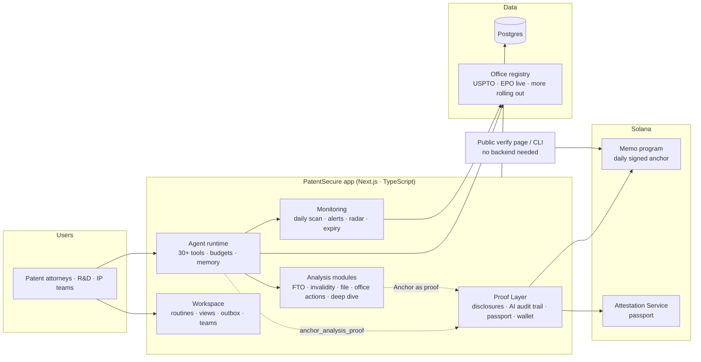

| Concern | Choice |
|---|---|
| Framework | Next.js (App Router), React, TypeScript (strict) |
| Data | Serverless Postgres (Neon) with a type-safe ORM; company-scoped access everywhere |
| AI | Multi-provider fallback chain across major AI providers; models configured by environment, never hard-coded; budgets and prompt caching |
| Offices | Capability-tiered registry (native adapters → DOCDB backbone → deep links); every answer names its source |
| Automation | Daily scan, 30-minute agent tick and daily renewal check as thin authenticated triggers; the real work runs server-side under a time budget |
| Email | Transactional API; localised dark-mode templates; one-click unsubscribe |
| Chain | `@solana/kit`, Memo program, Solana Attestation Service; Wallet Standard on the client |
| Standards | RFC 8785 (JSON canonicalisation), RFC 6962 / 9162 (Merkle trees), Sign-In-with-Solana |
| Deploy | Vercel + Neon; the demo instance is a separate, password-gated project with its own database |

---

## 6. Try it: judge quick-start

### 6.1 The live instance (about 3 minutes)

1. Open https://patentsecure-bli.vercel.app — enter the gate password from the submission form (any username), then sign in with the judge account from the same form.
2. **Dashboard → Analysis → Proof.** Read the "What a proof does — and does not do" box.
3. **Add proof** → *Text* (or *File*). Only a fingerprint is sent. Add a second record with the *AI audit trail* tab if an agent run exists on your account.
4. Press **Anchor now** (enabled for the judge account) — or wait for the daily batch. The record turns *Anchored* and shows a link to the Solana transaction.
5. **Download proof** and **Download snapshot**.
6. Open **`/en/verify`** (no login). Upload the snapshot and the bundle, press **Verify**: four green checks. Edit one character in the snapshot and verify again: **Not verified**.
7. **Issue passport** to create the attestation; **Link wallet** to name a wallet as holder (needs a Solana wallet extension).
8. Optional: ask the agent *"Status and next step for EP4122556A1"* and watch it answer from the live EPO register with sources.

### 6.2 This repository (about 2 minutes)

```bash
npm install
npm test                      # unit, property and end-to-end tests (no network needed)
# verify a real proof anchored on Solana devnet (reads the transaction from the public RPC)
npx tsx scripts/proof-cli.ts verify examples/devnet/b.txt.proof.json examples/devnet/b.txt \
  --trust B5wGo7Yp7TmLdXAV5Zkn9xRMvZc3dzkozf5yweUPf6vJ
# a tampered copy of the file → exits non-zero
cp examples/devnet/b.txt /tmp/b-tampered.txt && echo x >> /tmp/b-tampered.txt
npx tsx scripts/proof-cli.ts verify examples/devnet/b.txt.proof.json /tmp/b-tampered.txt --trust B5wGo7Yp7TmLdXAV5Zkn9xRMvZc3dzkozf5yweUPf6vJ
# the static verification page (one self-contained file)
TRUSTED_ANCHORERS=B5wGo7Yp7TmLdXAV5Zkn9xRMvZc3dzkozf5yweUPf6vJ npm run build:verify   # → dist/verify.html
```

The three example documents were anchored in one batch on **devnet** (transaction `iMiFpvUihH8odt6WtQsVgXdXEokp26nUrF46zD4c52n7GohYrt737sHzjJaBg1DdVhViQd32f85uycYL8HE52FG`, anchorer `B5wGo7Yp7TmLdXAV5Zkn9xRMvZc3dzkozf5yweUPf6vJ`). CLI: `keygen <keyfile>` · `airdrop <keyfile> [sol]` (devnet) · `anchor <keyfile> <cluster> <outdir> <file…>` · `verify <bundle.json> <file> --trust <addr[,addr]>`. The key file must live outside the checkout; use throwaway keys only.

### 6.3 Connecting the module to your own product

This repository has no database, web server or UI of its own. A host application connects it with four small pieces:

1. **Records:** call `commit` (`lib/proof/commit.ts`) with the file or JSON to fingerprint; store the leaf and salt next to your record.
2. **Batching and anchoring:** collect pending leaves, build the tree and call the Solana Memo adapter (`lib/proof/anchor.ts`, `lib/proof/chain/solana-memo.ts`) with your anchorer key, on any schedule (PatentSecure runs it daily).
3. **Bundles:** hand users the proof bundle (`lib/proof/bundle.ts`) with the exact file or snapshot.
4. **Verification:** `lib/proof/verify.ts`, the CLI, or the static `verify-page/` — no host backend needed.

---

## 7. What is in this repository

```
README.md                  this document — the full description of what we submit
assets/                    screenshots
lib/proof/                 the Proof Layer module
  canonical.ts             RFC 8785 JSON canonicalisation
  commit.ts                digests, salts, leaf bytes, kind tags
  merkle.ts                RFC 6962 tree, inclusion proofs
  bundle.ts                proof-bundle schema and (de)serialisation
  anchor.ts                batch → memo → anchored bundle
  verify.ts                the four-check verifier
  chain/adapter.ts         the only chain-specific seam
  chain/solana-memo.ts     Solana Memo adapter (signed memo)
  __tests__/               unit, property-based and end-to-end tests
scripts/proof-cli.ts       keygen · airdrop · anchor · verify
verify-page/               backend-free verification page (built to one HTML file)
examples/devnet/           three real anchored documents with their proof bundles
```

The PatentSecure app itself — agent, analyses, monitoring, billing, dashboard and the server side of the Proof Layer — runs at the demo instance above.

---

## 8. Quality, security and honesty

- **Tests.** About 3,700 automated tests across the app (agent tools, office adapters, monitoring, analysis modules, i18n consistency, API routes); this component ships 55 tests including **property-based tests** (any single-bit tamper of leaf, root or path fails; proofs are bound to their index) and Merkle roots checked against the Certificate Transparency reference roots and an independent implementation. End-to-end checks run against a real database and the real chain; a live smoke test (login → record → real anchor → bundle → passport → wallet link → replay refusal → cron protection) passes 17/17 on the demo instance.
- **Boundary.** `lib/proof` imports nothing from the rest of the app — enforced by a test — so it stays self-contained. A gate test keeps the app's code, deployment names and secrets out of this repository.
- **Security.** Hash-only by design; the anchorer key lives only in the server environment; cron routes fail closed without a secret; wallet links use single-use nonces with domain and time re-checks and replay refusal; passport issuance has a per-tenant cap, atomic reservation and a separate issuer key; CSRF, rate limits, strict CSP and company scoping apply to every proof route.
- **Honest limits.** The demo instance runs on **devnet** with throwaway keys. Devnet can be reset. The Memo program lets anyone write any text — which is exactly why verification pins the signer. A proof is evidence of existence and integrity, not of priority, ownership or correctness.

---

## 9. Why it fits the tracks

**LegalTech & RegTech.** Patent and trade-secret work depends on being able to show *when* something existed and *how* a conclusion was reached. The Proof Layer gives IP teams privacy-preserving, independently verifiable evidence for exactly that, with explicit legal guard-rails (no priority claim, no ownership token, no legal advice) and an audit trail for AI-assisted analyses — a direct answer to the transparency and accountability expectations around AI in regulated professional work.

**AI × Blockchain.** The AI agent's own work product — the steps it took, the sources it cited, the result it produced — becomes a committed, verifiable artefact: the agent can anchor its analysis itself, and anyone can later check that the analysis was not altered. The chain holds one 32-byte root per day; the AI, the data and the content stay private.

**Practical and shippable.** It is integrated into a live product with real users' workflow, uses standard primitives (SHA-256, RFC 6962, RFC 8785, Solana Memo, Solana Attestation Service), costs a fraction of a cent per daily batch regardless of volume, and degrades gracefully (unreachable chain ⇒ `unreachable`, never a false verdict).

---

## 10. Roadmap

- **Proof Layer:** mainnet anchoring for production tenants; additional chain adapters behind the same `ChainAdapter` seam; batch export for audits; selective disclosure (reveal one field of a snapshot against its root); scheduled re-verification.
- **PatentSecure:** more offices rolling out beyond USPTO and EPO; open self-serve pricing; further releases (enterprise features, deeper intelligence, scale and expansion), then customer-driven add-ons such as mobile, custom alert channels and custom workflows.

---

## 11. Links and license

- Demo instance: https://patentsecure-bli.vercel.app
- Hackathon: https://dorahacks.io/hackathon/legal-hack-2026

### License

This repository is licensed under the **Apache License 2.0** — see [LICENSE](LICENSE) and [NOTICE](NOTICE). Copyright 2026 FutureWebService.
